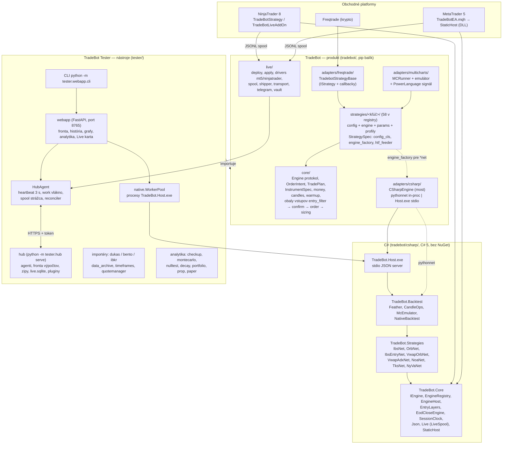
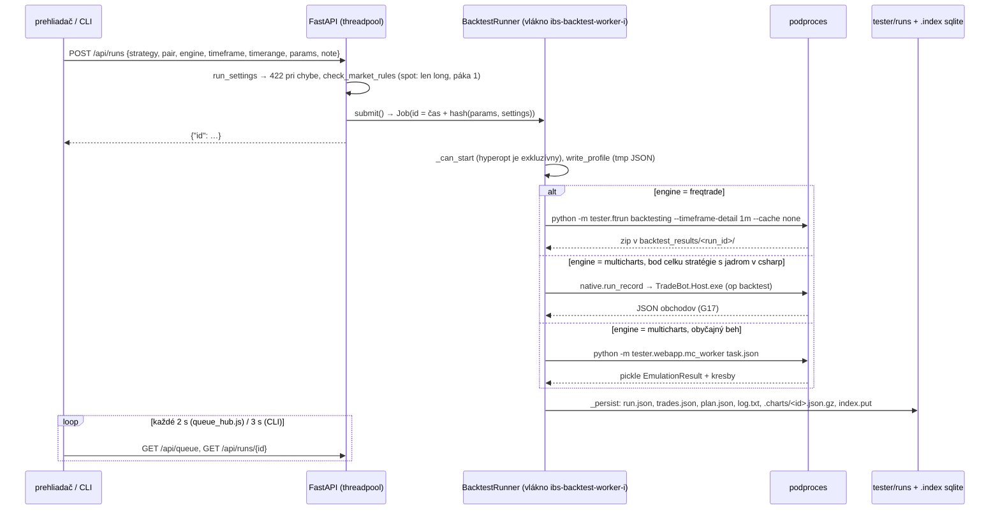
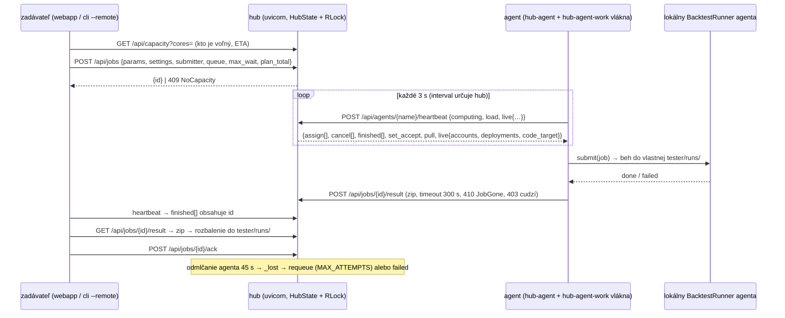
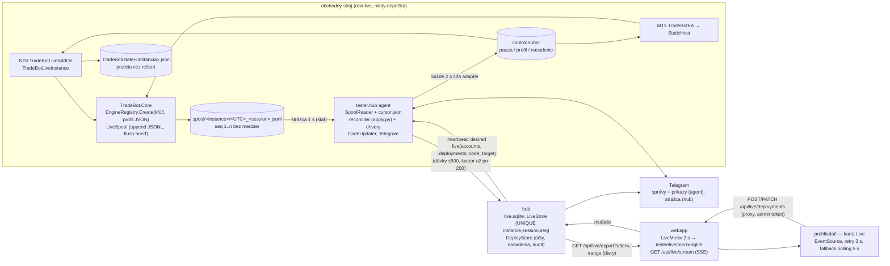

# Audit architektúry a kódu: error handling, logika, obnova spojenia, výkon

Dátum: 25. 10. 2026. Auditovaný commit: `fbb1de025` (`main`). Audit kódu a lokálneho stavu
repozitára, nie posudok ziskovosti stratégií. Nadväzuje na [AUDIT_main_2026-09-17.md](AUDIT_main_2026-09-17.md);
stav jeho nálezov je v §7.

## 1. Záver

Architektúra má zdravú kostru a od septembra sa zlepšila: peniaze sú na jednom mieste
(`core/money.py`), skladanie TF má jedno pravidlo, hub prežije reštart, telemetria z platforiem
je append-only s idempotentným skladom a C# jadro je s Pythonom porovnávané bar po bare.
Celá sada testov: **3 226 passed, 30 failed, 401 skipped (14,5 min)** — všetkých 30 pádov je
„definícia hotového" (29 stratégií bez analytiky a posudku, 1 test nepozná novú stratégiu),
nie regresie kódu.

Najvážnejšie problémy ležia na troch hraniciach:

1. **Backtest ≠ to, čo sa obchoduje.** Market vstupy idú vo Freqtrade ako limitka na close
   signálnej sviečky (po gape obchod chýba alebo má inú cenu), emulátor MultiCharts štartuje bez
   predhistórie a pri dvoch čakajúcich orderoch IBS adoptuje cudzí SL/TP (pretrváva od septembra).
2. **Profil v živej platforme ≠ profil v backteste.** C# zapína obaly vstupov (filter trendu,
   potvrdenie, typ orderu, sizing) podľa *prítomnosti kľúčov* v JSON, Python podľa *hodnôt configu*;
   čiastočný alebo ručne upravený profil v NinjaTraderi či MT5 obchoduje inú stratégiu než Tester.
   C# navyše neznáme hodnoty enumov ticho berie ako default.
3. **Stav, ktorý sa stráca pri páde procesu.** Vypnutie webapp počas behu nechá sirotu Freqtrade a
   beh bez `run.json`; reštart agenta hubu nahlási výpočet ako zlyhaný s prázdnou chybou a sľúbený
   druhý pokus sa nespustí; opakovaný import dát prepíše celý ročný súbor archívu aj čiastočným
   exportom; `run.json`, profily a analytiky sa píšu neatomicky.

Connection recovery je navrhnutá správne (agent ťahá, kurzory sa posúvajú až po potvrdení,
idempotencia podľa `(instance, session, seq)`), medzery sú v detailoch: bez backoffu a jitteru,
heartbeat neoveruje inštanciu agenta (dva procesy s jedným menom počítajú to isté), zlyhanie
zápisu `state.json` hubu je neviditeľné, SSE stránky blokuje event loop git podprocesmi.

Výkon: hub prepisuje celý `state.json` pri každom heartbeate (pri 2 000 bodoch mriežky ~1 s a 3 MB
každé 3 s), webapp pri viacerých cestách deserializuje celú históriu behov na jeden dopyt, index
histórie sa po prvej sqlite chybe natrvalo vypne, emulátor a IBS stavový automat majú známe O(n²)
miesta, pool C# procesov nemá timeout.

Poradie opráv odporúčam podľa §9: najprv hranicu backtest/platforma (N-CORE-1, N-CS-1, N-CORE-2),
potom stratu stavu pri páde (N-WEB-1, N-HUB-1, N-DATA-1, atomické zápisy), potom výkon.

## 2. Rozsah a metóda

| oblasť | kód | čo sa kontrolovalo |
|---|---|---|
| jadro a backtest adaptéry | `tradebot/core` 4,1 k riadkov, `tradebot/adapters/{freqtrade,multicharts,csharp}` | exekučný kontrakt, fill model, sizing, peniaze, warmup, DST, výkon slučiek |
| stratégie | `tradebot/strategies` 38 k riadkov, 58 kľúčov v registry | vzorky `ibs`, `orb`, `vwaporb`, `noa`, `tks`; opakujúce sa vzory |
| C# jadro | `tradebot/csharp/` 11,9 k riadkov, 8 C# stratégií, most, native pool | parita s Pythonom, culture, zaokrúhľovanie, alokácie, protokol mosta |
| webapp + CLI | `tester/webapp` 18,8 k riadkov, 16 routerov, 96 endpointov | fronta, perzistencia, index, súbežnosť, API kontrakt |
| hub + agent + telemetria | `tester/hub` 7 k riadkov, `tradebot/live/{transport,shipper,spool,journal,store}` | obnova spojenia, stav na disku, idempotencia, zámky |
| live obchodovanie | `tradebot/adapters/{ninjatrader,mt5}`, `tradebot/csharp/TradeBot.Core/{Live,StaticHost}.cs`, `tradebot/live/*` | reštart s pozíciou, ordery, control, Telegram, tajomstvá |
| frontend + dáta | `tester/webapp/static/js`, importéry, `data_archive`, `timeframes`, `livedata`, `livesim` | SSE/polling, pollery, skladanie TF, archív, front-month |

Metóda: čítanie kódu šiestimi nezávislými audítormi (jeden na oblasť) s povinnosťou uviesť
`súbor:riadok` a verdikt **CONFIRMED** (overené čítaním, sondou alebo testom) alebo **PLAUSIBLE**
(mechanizmus je v kóde, spúšťač nebol reprodukovaný); kľúčové nálezy som následne overil
sám priamo v kóde. Read-only sondy bežali v dočasných adresároch; produkčný kód, dáta ani história
behov sa nemenili. Nemerané: živý broker, celý Freqtrade dry-run, NinjaTrader ani MT5 v behu.

Identifikátory nálezov: `N-<OBLASŤ>-<číslo>` (CORE, CS, WEB, HUB, LIVE, DATA, FE). Priorita:
**P1** = mení obchody alebo výsledky, môže stratiť peniaze/dáta alebo zaseknúť systém;
**P2** = významná chyba s užšou podmienkou; **P3** = kvalita, výkon, dokumentácia.

## 3. Architektúra

### 3.1 Komponenty a závislosti

Závislosť ide jedným smerom: Tester importuje produkt `tradebot`, produkt o Testeri nevie. Jadro aj
adaptéry nepoznajú stratégiu menom — všetko ide cez `StrategySpec` (Python) a atribút
`[TradeBotEngine("kľúč")]` (C#).

### 3.2 Beh backtestu (jeden stroj)

Bod celku (sweep, matica, overenie hyperoptu) ide namiesto do histórie do `tester/sweeps/<kind>-<id>.json`
(`BatchStore.add_point`, atomický zápis). Hyperopt beží ako `freqtrade hyperopt` podproces, natívny
hyperopt (Optuna) v procese webapp nad `native.POOL`.

### 3.3 Distribuované počítanie (hub a agenti)

Všetci agenti sú za NAT; verejný je len hub a **hub nikdy nevolá von**. Stav hubu je v
`tester/hub_data/state.json` (celý, atomicky, pri každom heartbeate), výsledky v `results/<job>.zip`.

### 3.4 Živé obchodovanie: telemetria a riadenie

Oneskorenie bar → stránka je 2–4 s; každý uzol smie byť dole a nič sa nestratí (spool je zdroj pravdy,
kurzor sa posúva až po 200 od hubu, sklad je idempotentný, zrkadlo dopytuje diery).

### 3.5 Procesy a vlákna

| proces | vlákna / podprocesy | poznámka |
|---|---|---|
| **webapp** (`uvicorn tester.webapp.app:app`) | sync endpointy v threadpoole; `ibs-backtest-worker-{i}` (default 1, agent hubu = sloty); `eta-<id>` pri hyperopte; `ThreadPoolExecutor(cpu)` pre plateau/walk-forward; `chart-replay`; `live-mirror` (2 s) + `live-data`; `HubAgent` 4 vlákna; `warm-cache`; `code-watch` (git ls-tree 20 s → `os.execv` reštart pri prázdnej fronte); `native.POOL` procesy `TradeBot.Host.exe` | jediný `async` endpoint je SSE `/api/live/stream`; všetky vlákna daemon, žiadny shutdown hook pre bežiace behy |
| **hub** (`python -m tester.hub serve`) | threadpool uvicornu; `Updater` (git fetch + reset, voliteľné); `DrainWatch` 10 s; jedno vlákno na plugin (`watchdog` 20 s, `livedata` 300 s, `ff_calendar` 20 s) | jeden `RLock` nad celým stavom; `POST …/result` je `async` a blokuje loop |
| **agent** (`python -m tester.hub agent` alebo vo webapp) | `hub-agent` (tick 3 s), `hub-agent-work` (upload, ship spoolu, reconciler, pull), `hub-agent-spool` (1 s stat), `hub-agent-telegram` | `HubHttp`: keep-alive spojenie per vlákno, connect 5 s × 3, read 30 s |
| **NinjaTrader 8** | AddOn + inštancie stratégií v AppDomain NT; `LiveSpool` timer | po rekompilácii generácie assembly v jednom AppDomain |
| **MetaTrader 5** | EA v threade grafu, DLL cez `StaticHost` | profil zo súboru `Common\Files\TradeBot\profiles\…` |
| **TradeBot.Host.exe** | 1 proces na worker, `RunBatchJson` vlastný thread pool (64 MB stack) | `GCLatencyMode.Batch`, idle 600 s |

### 3.6 Úložiská

| úložisko | formát | píše | číta | atomicky? |
|---|---|---|---|---|
| `data/archive/tester/<zdroj>/<trh>/<stem>.<rok>.feather` | feather, 1 súbor/rok, **jediné dáta v gite** | importéry (`write_years`), `data_archive split` | `merge` | nie — prepis celého roka (N-DATA-1) |
| `data/tester/…` + `.derived.json` | feather 1m + odvodené TF | `merge`, `timeframes.ensure`, adaptér `ensure_timeframe` | enginy, webapp graf | evidencia odvodených, split ich preskočí |
| `tester/runs/<id>/{run,trades,plan}.json, log.txt` | JSON, git | `RunStore.save` | webapp, CLI, analytika | **nie** (N-WEB-4) |
| `tester/runs/.index/runs.sqlite3` | sqlite WAL, odvodený | `RunIndex.put/sync` | `page/where/records` | self-healing, po chybe natrvalo `ok=False` (N-WEB-6) |
| `tester/sweeps/<kind>-<id>.json` | body celkov | `BatchStore.add_point` | sweep/matrix/hyperopt API | áno (tmp + replace) |
| `tester/profiles/*.json`, `tester/analytics/*.json`, `tester/archive/*.jsonl.gz + index.json` | JSON | profiles, anstore, archive | | **nie** |
| `tester/hub_data/state.json`, `results/*.zip`, `events.jsonl`, `tokens.json`, `live.sqlite` | JSON / zip / sqlite WAL | hub | hub, webapp (export) | state/tokens áno; zip nie |
| `tester/agent.json`, `agent_state.json`, `tester/live/cursor.json` | JSON | agent | agent | state/cursor áno; `agent.json` **nie** |
| spool `<platform>/TradeBot/spool/<instance>/*.jsonl` | JSONL, append-only, `schema: 1` | platforma (`LiveSpool`) | agent, webapp na obchodnom PC | flush po riadku, nikdy sa nemaže |
| `tester/live/mirror.sqlite`, `data/live/{candles,trades,instances}` | sqlite / feather po mesiacoch | `LiveMirror`, `livedata.export` | karta Live, Diverzifikácia | hub plugin pushuje uzavreté mesiace |

## 4. API a protokoly

### 4.1 HTTP API webapp (lokálne, bez prihlásenia, 16 routerov, 96 endpointov)

Pravidlá: JSON dnu aj von, čas ISO 8601 UTC, obdobie `YYYYMMDD-YYYYMMDD` (koniec nepatrí dnu),
chyba zadania 422 s vetou v `detail`, `fee` ako podiel na stranu. Schéma: `/docs`, `/openapi.json`.

| router | endpointy |
|---|---|
| **meta** | `GET /` · `GET /api/meta` (stratégie, páry, okná, enginy, fronta) · `GET /api/strategies/{key}/meta?v=` · `GET /api/strategies/{key}/explainer` |
| **profiles** | `GET /api/profiles?strategy=` · `POST /api/profiles` · `PATCH /api/profiles/{name}` · `DELETE /api/profiles/{name}` · `GET /api/profiles/{name:path}` |
| **runs** | `GET /api/runs?q&limit&offset` · `POST /api/runs` · `GET /api/queue` · `POST /api/queue/{job_id}/cancel` · `GET /api/runs/{id}` · `GET /api/runs/{id}/log` · `GET /api/runs/{id}/profile.json` · `DELETE /api/runs/{id}` |
| **sweeps** | `POST /api/sweeps` · `GET /api/sweeps?strategy=` · `GET /api/sweeps/{id}` · `POST /api/sweeps/{id}/cancel` · `POST /api/points/{run_id}/replay` |
| **hyperopt** | `GET /api/hyperopt/meta` · `POST /api/hyperopts` · `GET /api/hyperopts` · `GET /api/hyperopts/{id}` · `POST /api/hyperopts/{id}/continue` · `POST /api/hyperopts/{id}/plateau` |
| **native** | `GET /api/native/status` · `POST /api/native/backtests` (až 20 000 behov bez histórie) |
| **analytics** | `GET /api/analytics` · `GET /api/analytics/configs` · `POST /api/analytics/fill-windows` |
| **analytics_prepare** | `POST /api/analytics/prepare` (päť okien + syntetické dvojča, `dry_run`) |
| **analytics_history** | `GET/POST /api/analytics/history` · `GET/DELETE /api/analytics/history/{id}` · `POST …/{id}/note` · `GET …/{id}/zadanie` · `POST …/{id}/posudok` |
| **prop_paper** | `GET /api/ai/meta` · `GET /api/prop/meta` · `POST /api/prop` · `POST /api/paper` (píše `docs/merania`) |
| **matrix** | `GET /api/matrix/meta` · `POST /api/matrices` · `GET /api/matrices` · `GET /api/matrices/{id}` |
| **diversify** | `GET /api/diversify/trades?runs=` · `GET /api/diversify/live?fresh=` · `GET /api/diversify/livedata` · `GET /api/diversify/livedata/view?instance&profile&pair` |
| **hub** | `GET /api/hub` · `POST/DELETE /api/hub/config` · `POST /api/hub/token` · `POST /api/hub/jobs` · `POST /api/hub/runs` · `POST /api/hub/hyperopts` · `POST /api/hub/accept` · `DELETE /api/hub/undelivered` · `POST /api/hub/agents/{name}/update` · `DELETE /api/hub/agents/{name}` · `GET /api/hub/jobs?live=` · `GET /api/hub/jobs/{id}` · `POST /api/hub/jobs/{id}/cancel` |
| **live** | `GET /api/live` · `GET /api/live/stream` (SSE) · `GET /api/live/agents` · `POST/DELETE /api/live/agents/{name}/update` · `GET /api/live/profiles` · `GET /api/live/deploy-defaults` · `GET/POST /api/live/accounts` · `PATCH/DELETE /api/live/accounts/{id}` · `GET/POST /api/live/deployments` · `PATCH/DELETE /api/live/deployments/{id}` · `GET /api/live/audit` · `GET /api/live/{instance}/sessions` · `…/snapshot` · `…/lost` · `…/events` (účty a nasadenia sú proxy na hub, mutácie len s admin tokenom) |
| **chart** | `GET /api/runs/{id}/chart?from&to` (409 bez kresieb) · `POST /api/runs/{id}/chart` · `GET /api/runs/{id}/chart/status` · `GET /api/candles?pair&tf&from&to` · `GET /api/runs/{id}/montecarlo` |
| **git** | `GET /api/git/status` (robí `git fetch`) · `POST /api/git/pull` · `POST /api/git/push` |

Karty prehliadača a ich obnova: Fronta 2 s reťazou `setTimeout` kým nie je prázdna; Sweep 3 s,
Hyperopt a Matica 4 s kým beží; Hub 10 s (otvorená) / 30 s (bodka); Live SSE + nasadenia 15 s, po
chybe streamu 60 s polling 5 s; História a Analytika bez pollingu.

### 4.2 HTTP API hubu (verejné, `Authorization: Bearer <token>`)

`own` = agent len pod svojím menom, `admin` = hlavný token. Všetko okrem `/api/health` chce token.

| metóda a cesta | kto | účel |
|---|---|---|
| `GET /api/health` | ktokoľvek | ok + počet online |
| `GET /api/status` · `/api/agents` · `/api/plans` · `/api/events?limit&job&agent&event` · `/api/capacity?cores=` | token | prehľad, plány dávok, log udalostí, kapacita a ETA |
| `POST /api/hub/drain?stop&by` · `DELETE /api/hub/drain` | admin | ručný drain |
| `POST /api/agents/register` | own | registrácia (409 obsadené meno) |
| `POST /api/agents/{name}/heartbeat` · `POST …/bye` | own | heartbeat (3 s), odhlásenie pred reštartom |
| `POST /api/agents/{name}/accept?value` · `POST …/update` · `DELETE /api/agents/{name}?force&token` | admin | prijímanie, pokyn `git pull`, zabudnúť agenta |
| `POST /api/jobs` | own (submitter) | zadanie (409 `NoCapacity`, 422) |
| `GET /api/jobs?live&submitter` · `GET /api/jobs/{id}?payload` | token | stav (payload len strana výpočtu) |
| `POST /api/jobs/{id}/cancel?by` | zadávateľ / počítajúci / admin | zrušenie |
| `POST /api/jobs/{id}/result?status&error&run_ids&agent&version` | počítajúci | odovzdanie zipu (410 `JobGone`, 403 cudzí) |
| `GET /api/jobs/{id}/result` · `POST …/ack` · `DELETE /api/jobs/{id}` | zadávateľ / admin | zip, potvrdenie, zmazanie |
| `GET /api/tokens` · `POST/DELETE /api/tokens/{name}` | admin | tokeny agentov |
| `GET /api/plugins` · `/api/plugins/views` · `/api/plugins/{n}/views/{v}` · `/api/plugins/{n}/files[/{rel}]` | token | pluginy, pohľady pre Telegram, súbory (`livedata`) |
| `POST /api/live/events` | own | dávky spoolu → `LiveStore.ingest` (idempotentne) |
| `GET /api/live/instances[/{id}[/sessions|/events|/snapshot]]` · `/api/live/export?after=` · `/api/live/gaps` · `/api/live/range` | token | telemetria, zrkadlenie, diery |
| `GET /api/live/accounts[/{id}]` · `/api/live/deployments[/{id}]` · `/api/live/audit` | token | požadovaný stav nasadení |
| `POST/PATCH/DELETE /api/live/accounts[/{id}]` · `…/deployments[/{id}]` · `POST/DELETE /api/live/agents/{name}/update` | admin | mutácie nasadení, cieľový commit kódu |

### 4.3 Protokol mosta Python ↔ C#

| transport | kedy | volanie | formát |
|---|---|---|---|
| `InprocTransport` (pythonnet) | Windows / Mono, default | `EngineHost.OnBar(long t, double×5, long[] htfT, double[] htfV, double pos, double daily, bool, string openIds) → string` | primitívy dnu, JSON (G17) von; DLL načítaná `Assembly.Load(bytes)` raz na proces — po rebuild treba reštart |
| `StdioTransport` (`TradeBot.Host.exe`) | bez pythonnetu, hyperopt v podprocesoch | 1 riadok JSON = 1 požiadavka: `op ∈ {create, bar, seed, final, info, stats, strategies, backtest, quit}` | `double` ako 16-hex IEEE bitový vzor; config/instrument vnorený JSON reťazec; `{"error": …}` → `BridgeError`; **bez timeoutu na `readline`** |
| `native.WorkerPool` | body celkov, natívny hyperopt | `op backtest` → `NativeBacktest.RunCachedJson` | cache `Candles` ≤4 súbory, `EmuData` ≤16 okien na proces |
| NinjaTrader / MT5 | live | `EngineRegistry.Create(kľúč, profil JSON zo súboru, InstrumentSpec, TF)` priamo | žiadny JSON per bar; obaly vstupov nasadzuje `EntryLayers.Wrap` podľa kľúčov profilu (N-CS-1) |

### 4.4 Spool udalostí (platforma → agent → hub)

JSONL `schema: 1`, súbor `<yyyyMMdd-HHmmss UTC>_<session>.jsonl` v adresári inštancie
`<platform>_<account>_<symbol>_<tf>m_<strategy>`; `session` = 8 hex na jeden štart enginu, `seq` od 1
bez medzier. Druhy: `bar`, `order`, `fill`, `state`, `draw`, `hb` (ping s pozíciou u brokera od
commitu `fbb1de025`). Kľúč idempotencie `(instance, session, seq)`; diery hľadá zrkadlo webapp
(`GAP_CHECK_SECONDS`, `GAP_GRACE_SECONDS`) a dopytuje `GET /api/live/range`.

## 5. Nálezy P1

Každý nález má miesto v kóde, scenár, verdikt a návrh opravy. Kategória: **EH** error handling,
**LG** logická chyba, **CR** connection / restart recovery, **SP** výkon.

### Hranica backtest ↔ obchodovanie

**N-CORE-1 (LG, CONFIRMED) — Market vstupy idú vo Freqtrade ako limitka na close signálnej sviečky.**
`tradebot/adapters/freqtrade/callbacks.py:133-140` vracia `row.entry` pre každý signál, `SignalRow`
typ orderu nenesie, configy v `deploy/freqtrade/*.json` nemajú `order_types` → Freqtrade default
`limit`. Freqtrade 2026.8 limitku pre long oreže na `min(cena, high)` a plní len keď `low ≤ cena ≤ high`.
Scenár: ORB `entryMode=close`, NOA, TKS, VWAP ORB, IBS pin bar `Market` dajú signál na close 100,
ďalšia sviečka O105 L104 → vo Freqtrade **žiadny obchod** (po `unfilledtimeout` sa zruší), v emulátore
market na 105; gap nadol O98 H99 → Freqtrade plní na 99, emulátor na 98. Interný model
(`runner.py:210`, MARKET = vyplní vždy) pritom hlási FILLED, engine „drží pozíciu" a blokuje ďalšie
vstupy. Týka sa väčšiny nových stratégií. Oprava: preniesť `order_type` do `SignalRow` / stĺpca
`tb_order_type`; pri MARKET vrátiť z `custom_entry_price` `proposed_rate`; integračný test market
vstupu s gapom cez skutočný Freqtrade order.

**N-CORE-2 (LG, CONFIRMED sondou) — Emulátor MultiCharts adoptuje cudzí SL/TP a nevidí stop v minúte
vyplnenia (A3 a A4 zo septembra pretrvávajú).** `tradebot/adapters/multicharts/runner.py:296-307`
`_adopt_open_plan` berie posledný plán, `emulator.py:259-273` plní prvý order, `:312-314` prepíše
`active_stop/tp` plánom z runnera. Sonda: longy A(100/SL 90/TP 110) a B(95/85/105), vyplní sa A →
obchod má `stop_last=85`, `take_profit=105`, SL 90 sa nikdy nezasiahne. `emulator.py:271, 278-279`
(`filled_now = px == sub.open`): limit 100/SL 99, minúta O101 H101 L98 → výstup až v ďalšej minúte,
`ambiguous_minutes` to nepočíta. Oprava: emulátor odovzdá runneru `filled_order_id`, runner adoptuje
podľa id; v `_exit_fill` po vyplnení vnútri minúty riešiť jednoznačný zásah stopu.

**N-CS-1 (LG, CONFIRMED sondou) — C# zapína obaly vstupov podľa prítomnosti kľúčov v JSON, Python podľa
hodnôt configu.** `tradebot/csharp/TradeBot.Core/EntryLayers.cs:698-710` (`Wrap`: `cfg.ContainsKey("trendFilter")
&& cfg.ContainsKey("trendTF")`, `ContainsKey("entryConfirm")`, `ContainsKey("entryOrderType")`,
`Flag(cfg, "fixedQty")`) vs. `tradebot/core/entry_filter.py:217-222` (`getattr(cfg, "trendTF")` má
vždy default). Sonda: `{"trendFilter":"with"}` bez `trendTF` → C# bez filtra, Python s
`EntryFilterEngine`. Dnes to kryje len to, že `deploy.py:244` posiela `cfg.to_dict()` (všetky kľúče);
ručne upravený alebo starý profil v `TradeBot\profiles\` (NT8, MT5 ho čítajú priamo zo súboru) obchoduje
inú stratégiu než backtest. Parita to nestráži — všetky testy idú cez úplný `to_dict()`. Oprava: `Wrap`
rozhoduje podľa rozparsovaných hodnôt configu (malé rozhranie, ktoré každý C# config vystaví), nie
podľa `Dictionary`; parity test s čiastočným profilom zo súboru.

### Živé obchodovanie (NinjaTrader 8, MetaTrader 5)

**N-LIVE-1 (EH, PLAUSIBLE) — NT: výnimka pri odoslaní SL/TP necháva pozíciu bez ochrany natrvalo.**
`tradebot/adapters/ninjatrader/TradeBotLiveInstance.cs:843-866`: `t.Sl`/`t.Tp` sa priradia pred
`_account.Submit`; keď `Submit` vyhodí výnimku (spojenie dole, neplatná cena po gape), `catch` len
zaloguje. Ďalší `EnsureExits` ide do vetvy „navýš objem", lebo `t.Sl != null`, a `Alive()` na nikdy
neodoslanom orderi vracia true. Žiadny retry, žiadne trhové zatvorenie. Oprava: v `catch` `t.Sl =
t.Tp = null` a `RequestClose(id, t, "tb_close")`, alebo opakovať `EnsureExits` z hlavnej slučky, kým
oba nie sú `Working`.

**N-LIVE-2 (EH, PLAUSIBLE) — NT: zatvorenie trhom najprv zruší SL/TP; odmietnutý market = nechránená
pozícia a retry každé 2 s donekonečna.** `TradeBotLiveInstance.cs:870-908, 1083`. Scenár:
`tb_session_end` / EOD 15:59 NY, broker odmietne market (mimo hodín, `Connection` dole) → pozícia cez
noc bez stopu + spam odmietnutých orderov. Oprava: po N neúspechoch položiť SL/TP znova
(`EnsureExits`) + `note error`; alebo rušiť len TP a nechať SL stáť, kým market neprejde.

**N-LIVE-3 (EH, CONFIRMED cesta) — MT5: `ClosePosition` a `Flatten` nekontrolujú návratový kód.**
`tradebot/adapters/mt5/TradeBotEA.mqh:1079-1096`: hedging `g_trade.PositionClose()` bez kontroly;
netting `CancelExits()` (zruší SL/TP) a potom `g_trade.Sell/Buy` bez kontroly a bez opakovania —
`Flatten` beží len na bare s `cs` alebo pri novom control súbore. Scenár: EOD close odmietnutý
(`REQUOTE`, `MARKET_CLOSED`, `TRADE_DISABLED`) → prop účet drží pozíciu cez noc, v nettingu bez SL/TP.
Oprava: kontrolovať výsledok ako v `SendEntry`, pri neúspechu `Report("error")`, ponechať `closing`
a opakovať z `OnTimer`.

**N-LIVE-4 (EH, CONFIRMED) — MT5 netting: odmietnutý SL order = pozícia bez stopu.**
`TradeBotEA.mqh:1058-1070` `PlaceExits` pri neúspechu len `Report("error")`, `slTicket` ostane 0, bez
retry a bez trhového zatvorenia (NT to rieši `RequestClose` v `HandleOrder:1086-1091`). Oprava: pri
`slTicket == 0` zavrieť trhom alebo opakovať z `OnTimer`.

**N-LIVE-5 (LG, CONFIRMED) — MT5: `OnDeinit` neruší čakajúce vstupy (GTC).** `TradeBotEA.mqh:654-669`
(NT `Teardown:1630-1640` ich ruší). Keď sa EA odoberie natrvalo (`active:false`, driver reštartuje
terminál s iným profilom grafov), `BuyLimit/SellStop` ostane u brokera; v nettingu vstup nenesie SL/TP
→ fill bez ochrany a bez EA. Oprava: v `OnDeinit` zrušiť pending ordery s vlastným magic; alebo
`remove_instance` drivera najprv zapíše `flatten`.

**N-LIVE-6 (LG, PLAUSIBLE) — MT5: vlastný fill sa spoznáva len podľa `DEAL_COMMENT == id`.**
`TradeBotEA.mqh:1204-1219`. Brokeri komentáre menia alebo orezávajú (FTMO dopisuje `[sl]`/`[tp]`).
Keď komentár nesedí, `FindOrder` zlyhá → `return`: pozícia otvorená, EA ju nesleduje (netting bez
SL/TP, bez trailingu a EOD), `HasOpenPosition()` vráti false → pyramídovanie. Oprava: párovať podľa
`DEAL_ORDER == orderTicket` / `DEAL_POSITION_ID`, komentár len ako záloha (`RestoreState` to už robí
cez `POSITION_IDENTIFIER:1436`).

**N-LIVE-7 (CR, CONFIRMED chýbajúci mechanizmus) — Zamrznutý feed alebo mŕtvy `BarsRequest` = tichá
smrť bez alarmu; EOD close závisí od príchodu baru.** `TradeBotLiveInstance.cs:586-599, 669-679`;
`TradeBotLiveAddOn.cs:338-346` (pri zmene pripojenia sa reštartujú len `Finished` inštancie);
`EodClose.cs:60-116`; MT5 `OnTick:714`. `hb` chodí ďalej → webapp hlási „trh zatvorený", strážca
(`tester/hub/plugins/watchdog`) stráži len agenta. Scenár: Rithmic reconnect o 15:40 NY, bary neprídu,
15:57 bar neexistuje → žiadny EOD close, trailing stojí, prop pravidlo porušené. Oprava: v `Run()`
slučke (každú sekundu aj bez barov) porovnať `Globals.Now` s očakávaným časom zatvorenia baru + TF;
pri prekročení počas seansy `note error` a pre EOD obaly `Flatten` podľa hodín; webapp/Telegram alarm
`closed` dlhšie než X počas seansy.

**N-LIVE-8 (EH, PLAUSIBLE) — NT chart `Strategy` bez try/catch v `OnBarUpdate/OnOrderUpdate/
OnExecutionUpdate`.** `TradeBotStrategy.cs:668-755, 927-988` (len control cesty sú chránené).
Výnimka z enginu alebo kreslenia (`BrushOf:1001` `int.Parse`) → NT stratégiu vypne; managed approach
pri vypnutí zruší `SetStopLoss/SetProfitTarget` → pozícia bez stopu; `StartBehavior.WaitUntilFlat:215`
bez stavu → po reštarte sa pozícia neprevezme. Oprava: obaliť vstupné body; do NINJATRADER.md napísať,
že chart Strategy je na porovnanie, nie na živý účet.

### Strata stavu pri páde procesu

**N-WEB-1 (CR, CONFIRMED) — Vypnutie webapp počas behu: beh zmizne bez stopy, Freqtrade podproces
ostane sirotou, CLI padne.** `tester/webapp/runner.py:121-127` worker je daemon bez shutdown hooku
(`__main__.py:154` registruje len `_hub_bye`). Ctrl+C počas behu → `tester.ftrun` počíta ďalej (drží
jadro, zip zapíše do `backtest_results/`), `run.json` nevznikne, po reštarte `runner.jobs` je prázdny →
`GET /api/runs/{id}` 404; CLI `_execute` (`cli/run.py:153-161`) `HTTPError` nechytá → sweep z CLI
skončí tracebackom. Oprava: `atexit`/`on_shutdown`, ktorý `kill_tree` bežiacich a zapíše ich ako
`failed` („webapp sa vypla"); CLI poll chytať `HTTPError/URLError` a opakovať.

**N-WEB-2 (EH, CONFIRMED logika) — Worker vlákno umrie, keď zlyhá `_persist` v chybovej vetve →
fronta visí „queued" donekonečna.** `runner.py:200-204`: v `except` sa volá `self._persist(job, None)`;
pri výnimke (plný disk, `PermissionError`) vyletí z `while True` a vlákno skončí; nové vznikne až pri
ďalšom `submit()`. Zvyšné body mriežky čakajú, kým niekto nezadá nový beh. Oprava: `try/except` okolo
`_persist` v handleri; `_loop` obaliť ďalším `try` bez `break`.

**N-WEB-3 (LG, CONFIRMED) — Natívny hyperopt a natívne body sa „nedajú zrušiť" (API 404), plateau
Freqtrade procesy prežijú zrušenie.** `runner.py:153-167`: `cancel()` pri `job.proc is None` (natívny
hyperopt v procese webapp `hyperopt_job.py:326+`, bod C# `runner.py:310`) vráti `False` →
`api/runs.py:60-64` 404. Natívny bod nemá `should_stop`, dobehne celý. Pri `select=plateau` /
walk-forward bežia backtesty cez `subprocess.run` bez uloženého `proc` (`hyperopt_job.py:222`) →
`kill_tree` ich nezasiahne. Oprava: `cancel()` vráti `True` vždy pri `running`; `_ft_points` drží zoznam
`Popen` na kill; `should_stop` do natívneho behu.

**N-DATA-1 (LG, CONFIRMED) — Opakovaný import prepíše celý ročný súbor archívu aj čiastočným exportom.**
`tester/dukas_import.py:181-183` (`write_years`: `part.to_feather(out)` bez zlúčenia s existujúcim
rokom), to isté `bento_import.py:291` a `ibkr_import.py:294` cez `store()`, ktoré hneď spustí `merge`.
Scenár: NAS100 importovaný 2021–2026, neskôr export len za október 2026 → `…-1m.2026.feather` obsahuje
len október, `merge` prepíše pracovný 1m, backtest za 2026 beží na mesiaci dát a webapp to ukáže ako
„dáta od … do …" bez varovania. Git blob sa dá vrátiť, ale nikto si to nevšimne. Oprava: pri existujúcom
roku načítať, `concat` + `drop_duplicates("date", keep="last")`, alebo odmietnuť zápis, keď nový rok
nepokrýva rozsah starého (`--replace`).

## 6. Nálezy P2 a P3 podľa oblastí

### 6.1 Jadro a backtest adaptéry

| ID | P | kat. | nález | miesto | verdikt |
|---|---|---|---|---|---|
| N-CORE-3 | P2 | LG | Emulátor štartuje bez predhistórie grafu a HTF: `BarHistory.atr` je 0 prvých ~14–55 barov, prahy v jednotke `atr` (`minImbSizePoints`, `confirmImbMinAtr`, `slBufferTicks`) sú 0; IBS `HTFFeeder` bez okna prvé 4 HTF bary. Freqtrade má `startup_candle_count` → iný prvý deň. Oprava: načítať `required_history` barov spred `from_ms` a prehrať bez obchodovania | `emulator.py:220, 235-236`; `history.py:86-92`; `htf.py:109-112` | CONFIRMED |
| N-CORE-4 | P2 | LG | `round_qty` useká o krok nižšie: `math.floor(0.3/0.1) = 2` → `round_qty(0.3) = 0.2`; `qty_for_risk(30, sl=100)` na kroku 0,1 dá 0,2; `EntrySizingEngine` môže zbytočne vynechať obchod pri `skipOverRisk`. Oprava: `floor(qty/step + 1e-9)` alebo `Decimal` | `tradebot/core/types.py:298-306` | CONFIRMED |
| N-CORE-5 | P2 | LG | `EntryOrderEngine` má iný fill model než adaptéry: limitka vyplnená len keď `low ≤ price ≤ high`, adaptéry plnia aj gap (`orders.entry_fills`). Gap cez limitku + round trip v jednom bare → CANCEL na vyplnený order, `dropped` pre stratégiu, kresba zmazaná | `entry_order.py:121` | PLAUSIBLE |
| N-CORE-6 | P2 | LG | Kolízia `run_id` v tej istej sekunde (A13 pretrváva): dvojklik alebo dvojité `replay` → `self.jobs[id]` prepíše Job, zbehne jeden | `store.py:66-69`; `runner.py:145-148` | CONFIRMED |
| N-CORE-7 | P3 | LG | PF bez strát = absolútny zisk | `money.py:244` | CONFIRMED |
| N-CORE-8 | P3 | LG | Interný model Freqtrade nekontroluje SL/TP na bare vyplnenia a používa bary grafu, nie 1m → obchod otvorený a zavretý v jednej sviečke engine vidí o bar dlhšie (ovplyvňuje `maxDailyWins`, blokovanie vstupov) | `runner.py:210-212` | CONFIRMED |
| N-CORE-9 | P3 | EH | Tiché degradácie: `timeframes.py:76-79` `except Exception → False` (IBS ďalej bez zón len s varovaním); `callbacks.py:124-126` chýbajúci detail → trailing potichu `after_stop`; `emulator.write_chart:425` prehltne všetko; `assert spec.engine_factory` zmizne pri `-O` | viď riadky | CONFIRMED |
| N-CORE-10 | P3 | SP | `SessionClock.state` 3× prevod cez `ZoneInfo` na každom bare bez cache; `StateMachine.on_bar` O(zón²) (strop 200); `BarHistory._sma` O(n) pri každom volaní; `bars_from_frame` 3× filtruje celý m1; IBS `_feed_informative` stavia dict celého HTF pri každom `populate_indicators` (v dry/live každú sviečku); `matrix.median_atr` Python slučka. Nálezy zo septembra neriešené | `clock.py:166-200`; `statemachine.py:121-124, 449-459, 649-656`; `emulator.py:220-236`; `matrix.py:105` | CONFIRMED |
| N-CORE-11 | P3 | LG | ORB: `entry` zaokrúhlené, `sl_distance`/`qty` z nezaokrúhlených; `st.trades += 1` počíta aj nevyplnenú RETEST limitku do `maxTradesPerDay` | `orb/engine.py:187-191, 411` | CONFIRMED |
| N-CORE-12 | P3 | LG | DST: `clock._timestamp_ms` pri nejednoznačnom čase berie `fold=0`; okná začínajúce 01:00–02:00 v deň jesennej zmeny; testy `SessionClock` na DST nie sú | `clock.py` | PLAUSIBLE |

Rozdiely Freqtrade vs. emulátor, ktoré FREQTRADE.md §G neuvádza: N-CORE-1, N-CORE-3, N-CORE-8 a
trailing (Freqtrade po minútach z 1m, emulátor na close baru grafu — zámer, je v docstringu).

### 6.2 C# jadro, stratégie, most

| ID | P | kat. | nález | miesto | verdikt |
|---|---|---|---|---|---|
| N-CS-2 | P2 | EH | Neznáme kľúče a neznáme hodnoty enumov sa ignorujú ticho: `entryOrderType` iné než `"limit"` → Market, `volFilter`/`trendFilter`/`entryConfirm` neznáme → Off/None. V NT8/MT5 profile `"Limit"` (veľké L) obchoduje market; Python by odmietol `ValueError`. Oprava: `ArgumentException` pri neznámej hodnote (ako `IbsConfig` pre `TradeDirectionMode`), neznáme kľúče do `Stats()/Info()` | `OrbConfig.cs:205-215, 235-250`; `IbsConfig.cs:233-242`; `NoaConfig.cs:58-73`; `NyVaConfig.cs:81-99` | PLAUSIBLE |
| N-CS-3 | P2 | LG | `EngineRegistry.Known()` pri duplicitnom kľúči v dvoch assembly vezme posledný; NT po rekompilácii drží starú aj novú generáciu `NinjaTrader.Custom.dll` → bez `Reset()` môže vzniknúť engine zo starej assembly | `Engine.cs:89-101` | PLAUSIBLE |
| N-CS-4 | P2 | CR | `StdioTransport._call` a `_Worker.call` bez timeoutu na `readline()`: uviaznutý `Host.exe` (nekonečná slučka, OOM mimo `try`) → Freqtrade backtest alebo fronta webapp visí, `WorkerPool` ho nikdy neuvoľní | `bridge.py:171-183`; `tester/native.py:95-108` | PLAUSIBLE |
| N-CS-5 | P2 | SP | Pamäť dlhožijúceho workera: `Prepared` drží až 16 `EmuData` (~30 MB/rok, 1m detail) + 4 `Candles` → 0,5–1 GB na proces × počet jadier pri hyperopte s 5 oknami a 2 TF | `NativeBacktest.cs:12-52` | PLAUSIBLE |
| N-CS-6 | P2 | LG | Parita nepokrýva: čiastočný profil zo súboru (N-CS-1), `nyvaesnet` a `ibsentryesnet` v `test_csharp_backtest.py::CASES`, stdio transport len pre `ibsnet`, vlákna vs. procesy len cez súhrn | `test_csharp_parity*.py`, `test_csharp_backtest.py`, `test_native_modes.py` | CONFIRMED |
| N-CS-7 | P3 | LG | `NyVaEngine.NyMs` `ConvertTimeToUtc` pri neexistujúcom čase hodí `ArgumentException`, pri dvojznačnom berie štandardný offset (len kresba); `NyVaEngine.cs:316` iteruje `OpenOrderIds` bez zoradenia; `Ema` alpha z pôvodného `n` (n ≤ 0 → alpha ≥ 1); `IbsEngine` neklampuje `chartTfMinutes`; `Feather.Read` pri skrátenom súbore holý `IndexOutOfRangeException` bez cesty | `NyVaEngine.cs:145-148`; `Ma.cs:17-22`; `Feather.cs:112-121` | CONFIRMED |
| N-CS-8 | P3 | SP | Alokácie per bar: `ClockState.Backgrounds` 3 `DrawBg` + `List`; `SessionClock.State` ~4 `ConvertTimeFromUtc`; `OrbEngine.VolumeOk` `double[n]`; `EntryDraw.WithIds` 3 `HashSet` per obal; `McEmulator.Run` `List<double>`, `MarketContext`, `BarOutput`. Gen-0, pre 3m zanedbateľné | `SessionClock.cs:123-136`; `OrbEngine.cs:246-249` | CONFIRMED |
| N-CS-9 | P3 | CR | `_load_clr` cache: po rebuild DLL beží webapp so starou assembly (známe); `InprocTransport` bez `close()` | `bridge.py:84-109` | CONFIRMED |

Bez nálezu: culture (všetko `InvariantCulture`), zaokrúhľovanie (`Math.Round` ToEven = Python
`round`), DST v `SessionClock` (fold=0 ako Python, parity test cez jarný posun), `EodCloseEngine`
pre 1/3/5/15 m presne podľa docs.

### 6.3 Webapp backend a CLI

| ID | P | kat. | nález | miesto | verdikt |
|---|---|---|---|---|---|
| N-WEB-4 | P2 | EH | Neatomické zápisy `run.json`/`trades.json`/profilov/analytík/archívu (`open(..., "w")` bez tmp + `os.replace`; `batches._write_atomic` to má). Pád uprostred = rozbitý JSON; `_cached` ho ticho preskočí, index ho vymaže → beh zmizne z histórie | `store.py:93-97`; `profiles.py:261-264`; `anstore.py:98,124,163`; `archive.py:139-143` | CONFIRMED |
| N-WEB-5 | P2 | EH | Archív najprv maže, až potom píše register: pád medzi nimi = až 100 behov zmazaných z `runs/`, v `.jsonl.gz` sú, `index.json` o nich nevie, `restore` ich nenájde; `index.json` neatomicky → poškodený = celý archív neviditeľný | `archive.py:168-175, 197` | CONFIRMED |
| N-WEB-6 | P2 | SP | Index po prvej sqlite chybe natrvalo `ok = False` → každý zoznam číta všetky `run.json` do reštartu webapp (`database is locked` pri `cli reindex` 37 k behov; `--rebuild` maže súbor pod otvoreným spojením) | `index.py:199,211,253,336,356`; `cli/history.py:131-134` | PLAUSIBLE |
| N-WEB-7 | P2 | SP | SSE `/api/live/stream` blokuje event loop: v `async def gen()` priamo `stream_messages()` (sqlite) a `_deploy_state()` → `gitcode.version()` (git podproces, timeout 60 s) a `_pushed()` pri každej zmene zrkadla (2 s) pre každú kartu Live. Stojí celá aplikácia vrátane heartbeatu agenta | `api/live.py:514-550` | CONFIRMED |
| N-WEB-8 | P2 | SP | `store.tagged()`/`store.all()` = deserializácia celej histórie, opakovane v jednom requeste: `GET /api/sweeps`, `/api/sweeps/{id}`, `/api/matrices*`, `/api/hyperopts/{id}` 3×, `POST /api/hub/*`, CLI `_remote_submit` na každý bod mriežky, agent `_verification_ids` pri heartbeate | `store.py:348`; `api/sweeps.py:134,167`; `api/hyperopt.py:133,136,169`; `cli/remote.py:74,180`; `hub/agent.py:1032` | CONFIRMED |
| N-WEB-9 | P2 | SP | `/api/analytics/configs` číta celé `run.json` (aj `series`) pre každý beh skupiny; 5 000 behov = 5 000 čítaní, cache 256 sa pretáča; volá karta Diverzifikácia aj Analytika | `api/analytics.py:243-261, 323` | CONFIRMED |
| N-WEB-10 | P2 | CR | Pracovný proces C# bez timeoutu → beh „running" naveky; `atexit` zatvára len idle procesy | `tester/native.py:95-107, 166-174, 258` | PLAUSIBLE |
| N-WEB-11 | P2 | LG | Starvation exkluzívneho hyperoptu pri `workers > 1`: ostatní workeri berú z fronty ďalšie body aj zaradené po hyperopte → pri agentovi s 24 slotmi hyperopt nezačne, kým fronta nevyschne | `runner.py:178-197` | CONFIRMED |
| N-WEB-12 | P2 | EH | `GET /api/analytics/history` má zápisové vedľajšie účinky: pre až 500 záznamov `store.get()` + `anstore.patch()` (read-modify-write bez zámku) — dva súbežné GET sa prepíšu | `api/analytics_history.py:51-54` | CONFIRMED |
| N-WEB-13 | P3 | EH | Path traversal cez `run_id` na Windows: `store.get/trades/log` nevalidujú `_ID_RE` → `GET /api/runs/..\..\x` prečíta cudzí `run.json` (lokálna app) | `store.py:277,281,294` | CONFIRMED |
| N-WEB-14 | P3 | SP | `runner.jobs` rastie bez hraníc (Job s až 5 000 riadkami logu sa nikdy nemaže) | `runner.py:108,147-148` | CONFIRMED |
| N-WEB-15 | P3 | LG | Zníženie `workers` sa neprejaví, `start()` vlákna len pridáva | `api/hub.py:64-65`; `runner.py:121-127` | CONFIRMED |
| N-WEB-16 | P3 | EH | Nezamknuté pamäťové cache (`OrderedDict` `move_to_end` KeyError → 500) | `store.py:188-210`; `api/common.py:30-39` | PLAUSIBLE |
| N-WEB-17 | P3 | CR | Git bez timeoutu a bez zámku; `status()` robí `git fetch` pri každom volaní; dva Push → `index.lock` | `gitsync.py:61-65, 137-141` | PLAUSIBLE |
| N-WEB-18 | P3 | CR | `POST /api/native/backtests` čaká na pool bez timeoutu | `native.py:136-137` | PLAUSIBLE |
| N-WEB-19 | P3 | — | Docs vs. kód: API.md „cancel zruší hyperopt" (natívny 404); WEBAPP.md „LiveMirror 5 s" (kód 2 s); „Push commitne len runs/sweeps/profiles/analytics" (aj `archive/`); API.md nepokrýva analytics/history, diversify, git, hub config, live | `docs/API.md:42`; `docs/WEBAPP.md:494-495, 591` | CONFIRMED |

Bez nálezu: index ↔ súbory (test zelený), spot/short/páka (klient aj server), hranice `timerange`,
fee ako podiel všade, párovanie profil ↔ stratégia, zlučovanie epoch pri `continue`.

### 6.4 Hub, agent, telemetria

| ID | P | kat. | nález | miesto | verdikt |
|---|---|---|---|---|---|
| N-HUB-1 | P2 | CR | Reštart agenta uprostred behu: `_settled` beh, ktorý nepozná runner ani história (`run.json` vzniká až na konci), vyhodnotí ako `failed` s chybou `""`; `_accept` nové pridelenie toho istého `job_id` odmietne (starý záznam v `computing`); hub `result` od toho istého agenta prijme, hoci práve requeue-ol. Reboot srvnas s 8 behmi → 8× `failed` bez chyby, žiadny retry (HUB.md sľubuje „raz sa skúsi znova") | `agent.py:976-979, 1034-1046, 1079-1081`; `state.py:774-801` | CONFIRMED sondou |
| N-HUB-2 | P2 | CR | Heartbeat neoveruje `instance`: dva procesy s jedným menom (webapp agent + headless z toho istého `agent.json`, alebo proces „visiaci" počas výpadku) dostanú ten istý výpočet | `state.py:154-156, 199-200` | CONFIRMED sondou |
| N-HUB-3 | P2 | EH | Zlyhanie zápisu `state.json` (plný disk) neviditeľné: každý heartbeat 500, agent točí register/heartbeat, hub v pamäti ďalej prideľuje; po reštarte sa vráti stav spred zaplnenia, pridelené výpočty hub nepozná → 404 → `undelivered`; `events.py:52-53` `except OSError: pass` | `state.py:134-140, 253, 654, 803` | PLAUSIBLE |
| N-HUB-4 | P2 | LG | Requeue pri `accept=False` nezapíše `lost_agents` → neskorý výsledok 403 → `undelivered` | `state.py:223-227` vs. `510-515`; `agent.py:1105-1106` | CONFIRMED sondou |
| N-HUB-5 | P2 | SP | `SpoolReader.read` číta celý zvyšok súboru pri každom volaní, spotrebuje len 500 udalostí → hub týždeň dole = desiatky MB × stovky kôl, kvadratické I/O v pracovnom vlákne (blokuje aj upload výsledkov a reconciler) | `spool.py:193-196, 211`; `shipper.py:55` | PLAUSIBLE |
| N-HUB-6 | P2 | EH | `Updater.fast_forward` robí `git reset --hard FETCH_HEAD` bez kontroly špinavého stromu — hub lokálne s `--update 5` na vývojárskom klone zmaže necommitnuté zmeny | `update.py:69-78`; `__main__.py:138-158` | PLAUSIBLE |
| N-HUB-7 | P3 | SP | Celý `state.json` pri každom heartbeate a O(fronta × agenti × výpočty) v `_dispatch`: 600 vo fronte, 5 agentov → 82 ms pod globálnym zámkom a 856 kB zápisu na heartbeat; 2 000 bodov → ~1 s a ~3 MB každé 3 s | `state.py:253, 432-435, 476-481, 702, 716-724` | CONFIRMED meraním |
| N-HUB-8 | P3 | EH | `result()` mení výpočet pred zápisom zipu, zip bez tmp + rename; `POST …/result` je `async def` a blokuje loop (telo bez limitu veľkosti) | `state.py:783-795`; `server.py:305-316` | CONFIRMED |
| N-HUB-9 | P3 | EH | Rozbitý `state.json` → ticho prázdny hub, prvý `_save` ho prepíše | `state.py:118-124` | CONFIRMED |
| N-HUB-10 | P3 | EH | `AgentState.computing` menené v dvoch vláknach bez zámku → občasná `RuntimeError: dictionary changed size` | `agent.py:1001, 1113, 1177, 766-769` | PLAUSIBLE |
| N-HUB-11 | P3 | SP | Nevyzdvihnuté výsledky so zipom ostávajú navždy (`_prune`) | `state.py:831-849` | CONFIRMED |
| N-HUB-12 | P3 | EH | Live DB v heartbeate bez ochrany → chyba sqlite = 500 pre všetky heartbeaty, `/api/health` ok | `state.py:259, 280` | CONFIRMED |
| N-HUB-13 | P3 | CR | Bez backoffu a jitteru (agent 3 s, `client.wait` 5 s, po reštarte hubu všetci naraz); headless agent pri Ctrl-C nepošle `bye` (hub čaká 45 s); `agent.json` sa píše priamo (výpadok = agent nenabehne) | `agent.py:277-285`; `__main__.py:241-243`; `config.py:142-148` | CONFIRMED |
| N-HUB-14 | P3 | — | Testy závislé od prostredia: `test_hub.py:2383, 2445` padajú na stroji s NT8/MT5 (`default_roots`) | `tester/tests/test_hub.py` | CONFIRMED |
| N-HUB-15 | P3 | EH | Prenos zipu celý v pamäti bez limitu (robustnosť voči kompromitovanému agentovi) | `transfer.py:34-52, 81`; `server.py:312` | CONFIRMED |

Bez nálezu: HTTP timeouty všade, path traversal (`unpack_runs`, `plugin_file`), tokeny
`compare_digest`, aware UTC časy, sqlite WAL + indexy, idempotencia `result`/`ingest`, žiadne holé
`except:`, všetky vlákna daemon.

### 6.5 Živé obchodovanie — ďalšie nálezy

| ID | P | kat. | nález | miesto | verdikt |
|---|---|---|---|---|---|
| N-LIVE-9 | P2 | CR | Režim `flatten` sa po reštarte na prevzaté pozície neaplikuje: NT `ControlInit` beží pred `Replay/RestoreState` (`_orders` prázdne), MT5 `OnInit` len nastaví `g_mode`. Webapp ukazuje „flatten", pozícia beží ako paused | `TradeBotLiveInstance.cs:376, 395-396`; `TradeBotEA.mqh:336-341` | CONFIRMED |
| N-LIVE-10 | P2 | EH | Trailing: neúspešný posun stopu sa nezopakuje (`LastStop`/`lastStop` prepísané pred `Change`/`PositionModify`) → broker má starý stop, adaptér verí novému | NT `:1016-1025`; MT5 `:1126-1131` | CONFIRMED |
| N-LIVE-11 | P2 | LG | NT: každý `Rejected` na `<id>:sl` (aj rejekt *zmeny* pri trailingu) → `RequestClose` zdravej pozície | `TradeBotLiveInstance.cs:1080-1091` | PLAUSIBLE |
| N-LIVE-12 | P2 | CR | NT `ReconcileExternal` pri výpadku spojenia: `_account.Positions` bez pozície (kým sa účet nezosynchronizuje) → po 3 s falošný `fill out close`, zrušenie SL/TP, tracking zahodený; po reconnecte pozícia bez stopu. Bez kontroly `ConnectionStatus` | `:961-985` | PLAUSIBLE |
| N-LIVE-13 | P2 | LG | Dve inštancie na tom istom účte a inštrumente: `AccountPosition()` je netto (long 1 + short 1 = 0 → obe „zavrú" a zrušia si SL/TP); `HasOpenPosition()` parkuje vstupy B kým A má pozíciu; `Ours()` berie všetky pomenované ordery, exit fill nekontroluje referenciu → kolízia id (`LONG_<uid>`) | `:731, 926, 1035, 1136-1154`; `Zones.cs:69` | PLAUSIBLE |
| N-LIVE-14 | P2 | LG | Aktualizácia kódu s `force` pri čiastočnom neúspechu reštartuje MT5 terminály každých 5 min (NT nebeží → chyba → `install_code` znova pre každý driver) | `update.py:193, 213-223`; `agent.py:593-600`; `drivers/ninjatrader.py:345-356` | CONFIRMED |
| N-LIVE-15 | P2 | LG | Odstránenie nasadenia / `active:false` bez brány pozície: graf odobratý a terminál reštartovaný bez ohľadu na pozíciu (+ N-LIVE-5) | `update.py:93-94`; `drivers/mt5.py:551-567, 796-817` | CONFIRMED |
| N-LIVE-16 | P2 | EH | Heslo MT5 ostáva v `start.ini` čitateľne, keď štart zlyháva alebo `charts` je prázdne; bez ACL; heslo v heartbeate čitateľne cez `http://` sa neodmieta | `drivers/mt5.py:672-683, 789-790, 812-817, 837-848`; `deploy.py:710-722` | CONFIRMED |
| N-LIVE-17 | P2 | EH | Telegram: `format_event` mutuje `ctx["open"]` pred `_send_all`; pri `TelegramError` sa stav uloží, `seq` nie → vstup pripočítaný druhýkrát, `/status` ukazuje LONG 2; jedna otrávená správa (403/400) zastaví všetky | `telegram.py:409-423, 647-649, 660-674` | CONFIRMED |
| N-LIVE-18 | P2 | EH | `admins` prázdne = ktokoľvek v chate aj skupinovom; `/pause N` podľa čísla môže trafiť inú inštanciu | `telegram.py:971-972, 1170-1171` | CONFIRMED |
| N-LIVE-19 | P2 | CR | Rozbitý spool = trvalé vypnutie telemetrie vrátane `hb` bez alarmu (`Break → Broken=true`, žiadny reopen; watchdog stráži len agenta) | `Live.cs:219-229`; NT `:243`; `watchdog/plugin.py:52-64` | CONFIRMED |
| N-LIVE-20 | P2 | LG | Sizing: podlaha 1 kontrakt / min lot prebije riziko (`Math.Max(1, Round(plan.Qty))`, `MathMax(minQty, floor)`); chráni len `skipOverRisk`, predvolene false; `ticks_to_points` prepočíta len `SIZE_FIELDS` v tickoch pri známom nástroji | NT `:821`; MT5 `:871-877`; `EntryLayers.cs:656-663`; `deploy.py:201-227` | CONFIRMED |
| N-LIVE-21 | P2 | LG | MT5: ručné zatvorenie pozície s iným magic EA nevidí → fantómová pozícia, nový vstup zaparkovaný navždy, zmena profilu čaká | `TradeBotEA.mqh:1192` | PLAUSIBLE |
| N-LIVE-22 | P2 | LG | Rollover (NT): filtre podľa `FullName`; po zmene symbolu na `MNQ 03-27` `RestoreState` SL/TP starého kontraktu nenájde → `lost` + pozícia na starom kontrakte bez trailingu/EOD | `:738, 1418, 1427` | CONFIRMED cesta |
| N-LIVE-23 | P3 | LG | `Replay()` dáva enginu počas histórie `PositionSize` živého účtu (nedeterministický replay); generácie AddOnu 3 s vs. 15 s → krátko dve inštancie na účte; `deploy.py:775` porovnáva hodiny hubu s hodinami agenta; `TelegramState.data` bez zámku; F5 cez `SendInput` bez overenia popredia; `SetDeviationInPoints(10)` = 0,1 bodu na US100.cash → requote; `position_from_spool` počíta aj `ready:false` a nezabúda stratený `out`; `SystemExit` z `write_control` zabije vlákno Telegramu; denný limit výhier podľa UTC dňa, nie seansy | viď riadky v správe audítora | — |

K commitu `fbb1de025` (obnova NT po reštarte): `RestoreState` je premyslený (účet = pravda, plán zo
stavu, exekúcie počas výpadku, cancel čakajúcich). Neúplné: `flatten` po reštarte (N-LIVE-9),
`AccountPosition` ako pravda je krehké pri výpadku a pri dvoch inštanciách (N-LIVE-12, 13),
`Account.Executions` nemá exekúcie spred pripojenia (výstup počas vypnutého NT sa do denníka
nedostane), trailing potomkov `TrailingPlan` sa nezapisuje (dokumentované), `pos_of=magic` (MT5) vs.
`account` (NT) nie je rovnaký význam, naživo neoverené (docs priznávajú).

### 6.6 Frontend a dáta

| ID | P | kat. | nález | miesto | verdikt |
|---|---|---|---|---|---|
| N-FE-1 | P2 | EH | Reťaz `pollQueue` zomrie pri prvej chybe `fetch` (reštart webapp, 502) → karta Fronta navždy so starým „running", `loadRuns()` sa nezavolá; `loadHub` to má správne cez `try/finally` | `queue_hub.js:8-9, 53-54`; `main.js:51` | CONFIRMED |
| N-FE-2 | P2 | LG | Odhad pozície na karte Live: `lastIn = max(ft)` cez všetky `in` filly bez ohľadu na id → čiastočné vyplnenie toho istého vstupu (qty 2 po 1) sa označí ako „neskôr vstúpila inde", pozícia `0 ?`, chip `≠` falošne; server (`dashboard/live.py:171-177`) porovnáva len iné obchody | `live.js:344-364` | CONFIRMED |
| N-FE-3 | P2 | LG | `loadLiveFills` max 5 000 riadkov bez stránkovania; pri streame sa zvyšok nikdy nedotiahne → filly medzi 5 000. riadkom a kurzorom chýbajú | `live.js:327-339`; `store.py:221-235` | PLAUSIBLE |
| N-DATA-2 | P2 | LG | Odvodené TF ostanú zastarané, keď sa 1m zmení počas behu webapp (`ensure()` len pri štarte; adaptér odvodzuje len keď súbor chýba) → beh na starom 3m a novom 1m detaile | `timeframes.py:104-118`; `adapters/freqtrade/timeframes.py:51-53` | PLAUSIBLE |
| N-DATA-3 | P2 | LG | livesim: zdroj, ktorý má v košíku TF aspoň jeden bar, berie celý košík → neúplný živý 1m košík (2 z 5 minút) prebije úplný bar grafu | `livesim.py:114-133` | PLAUSIBLE |
| N-DATA-4 | P2 | LG | `data_archive split` porovnáva len počet riadkov → opravená sviečka s rovnakým počtom barov sa do archívu nedostane | `data_archive.py:106` | CONFIRMED |
| N-FE-4 | P3 | LG | `STRATEGIA_TRH_TYP` nepokrýva `asiasweep` (→ OSTATNÉ); 422 z Pydanticu ako surový JSON; `openRun` bez catch; pollery sweep/hyperopt/matrix opakujú navždy aj pri 404; stará stránka proti novému API bez detekcie | `settings.js:529-552`; `core.js:73`; `history.js:92-109`; `api/meta.py:40-46` | CONFIRMED |
| N-FE-5 | P3 | SP | SSE backlog: starý `after` → celá história po 5 000, pri vybranom behu `snap.bars` sa nestrihá a každá udalosť prekreslí Plotly | `api/live.py:515-521`; `live.js:120-187` | CONFIRMED |
| N-DATA-5 | P3 | SP | livesim cache `rglob` + `stat` nad všetkými `candles/*`; `quotemanager.write_csv` riadok po riadku cez `itertuples` | `livesim.py:246-249`; `quotemanager.py:84-92` | CONFIRMED |
| N-DATA-6 | P3 | LG | Front-month podľa UTC dňa (prepnutie o 00:00 UTC uprostred Globex seansy — zlé pre nočné stratégie); posledná odvodená sviečka môže byť neúplná; `livedata._merge_candles` „prvý vyhráva", kurzor exportu sa po reimporte skladu s inými id neresetuje | `bento_import.py:151-168`; `candles.py:67-73`; `livedata.py:140-160, 310-313` | PLAUSIBLE |

Bez nálezu: jedno pravidlo skladania TF (`candles.resample_ohlcv`) vo všetkých cestách (grep),
`.derived.json` evidencia (odvodené sa do archívu nedostane), `merge_root` dedupe a triedenie, IBKR
DST (`ambiguous="raise"` padne nahlas), klientská validácia zodpovedá serverovej.

### 6.7 Index podľa kategórie

| kategória | P1 | P2 | P3 |
|---|---|---|---|
| **error handling** | N-LIVE-1, 2, 3, 4, 8; N-WEB-2 | N-CS-2; N-WEB-4, 5, 12; N-HUB-3, 6; N-LIVE-10, 16, 17, 18; N-FE-1 | N-CORE-9; N-WEB-13, 16; N-HUB-8, 9, 10, 12, 15 |
| **logické chyby** | N-CORE-1, 2; N-CS-1; N-LIVE-5, 6; N-WEB-3; N-DATA-1 | N-CORE-3, 4, 5, 6; N-CS-3, 6; N-WEB-11; N-HUB-4; N-LIVE-9, 11, 13, 14, 15, 20, 21, 22; N-FE-2, 3; N-DATA-2, 3, 4 | N-CORE-7, 8, 11, 12; N-CS-7; N-WEB-15, 19; N-LIVE-23; N-FE-4; N-DATA-6 |
| **connection / restart recovery** | N-LIVE-7; N-WEB-1 | N-CS-4; N-WEB-10; N-HUB-1, 2, 5; N-LIVE-12, 19 | N-CS-9; N-WEB-17, 18; N-HUB-13 |
| **výkon** | — | N-CS-5; N-WEB-6, 7, 8, 9 | N-CORE-10; N-CS-8; N-WEB-14; N-HUB-7, 11; N-FE-5; N-DATA-5 |

## 7. Stav nálezov z auditu 17. 9. 2026

| ID | stav | dôkaz |
|---|---|---|
| A1 jednotky futures | **opravené** | `core/money.py` (jediná definícia, `point_value` v zázname); `emulator.py:355-374`; `montecarlo.py:95`; `results.py:87-92`; `test_point_value.py` |
| A2 HTF okná pri väčšom grafe | **opravené** | `emulator.py:291-300` kŕmi HTF bary uzavreté do `bar.time+step` pred `on_bar` |
| A3 cudzí SL/TP pri viacerých orderoch | **pretrváva** | N-CORE-2 |
| A4 limitka uprostred minúty bez stopu | **pretrváva** | N-CORE-2 |
| A5 `maxDailyWins` v MC | **opravené** | `runner.py:238-257`; `emulator.py:302-303`; `signal.py:454-457` |
| A6 trailing gap/orb/range/sdzone vo Freqtrade | **opravené** | `runner.py:83` `SignalRow.trailing`; `base.py:254-312` |
| A7 typ orderu vo Freqtrade | **čiastočne** | interný model rozlišuje, skutočný order je stále limitka → N-CORE-1 |
| A8 validácia proti inému TF | **opravené** | `base.py:146-156` |
| A9 režim trhu s budúcnosťou | **opravené** | `tester/regime.py:192-199, 142` |
| A10 MC obchody vs. plán v analytike | **opravené** | `analytics.py:39-43, 128-141` |
| A11 front-month podľa objemu dňa | **čiastočne** | roll späť už nejde, deň stále podľa UTC objemu (N-DATA-6) |
| A12 MC bez predhistórie | **čiastočne** | seeded indikátory áno, predhistória grafu a HTF nie → N-CORE-3 |
| A13 rovnaké run_id v sekunde | **pretrváva** | N-CORE-6 |
| reprodukovateľnosť (verzia kódu v behu) | **neopravené** | `core/version.py:repo_version` existuje, runner ho nepoužíva |
| kontrakt schopností adaptérov | **neopravené** | `StrategySpec` nemá polia schopností |
| metriky DD / PF | **čiastočne** | DD zjednotené (`money.max_drawdown`); PF bez strát = zisk (N-CORE-7) |
| `duration_s` | **čiastočne** | zahŕňa `summarize`, nie persist |
| výber zipu | **opravené** | `runner.py:229-232` vlastný `backtest_results/<run_id>/` |
| margin / likvidácia | **nezmenené (model)** | `ftexchange.py:237-243`, emulátor bez marže |
| výkon zón / pivotov / seansových hodín | **neriešené** | N-CORE-10 |

## 8. Testy

**Sada:** `3 226 passed, 30 failed, 401 skipped, 14 min 34 s` (celá, bez `-x`). Pády:

- `tester/tests/test_checkup.py::test_kazda_strategia_ma_analytiku_a_posudok` — **29 stratégií bez
  `docs/ANALYTIKA.md` s posudkom**: fibo, fpc, fvgpolarity, fvgpolaritymgc, ibsentrymgc, ibsentrynet,
  ibsentryneteod, ibsfvg, ibszones, liquidity, noanet, noaneteod, onbiasorb, percoco, scalp3ma,
  scalp3mamgc, silverbullet, sweepengulf, sweepfvg, tks, tksnet, tksneteod, trendlines, varev,
  vwapadxnet, vwapadxneteod, vwapop, vwaporbnet, vwaporbneteod. Podľa STRATEGIE.md nie sú hotové;
  sedem z nich (`*net`, `*eod`) je pritom nachystaných na živý účet.
- `tradebot/tests/test_entry_confirm.py::…[ibsentryesnet]` — nová stratégia (commit `6c81096`) chýba
  v zozname `_OWN` stratégií s vlastným vstupným modelom.
- `tester/tests/test_hub.py:2383, 2445` (N-HUB-14): v celej sade prešli, pri samostatnom behu súboru
  na tomto stroji s NT8/MT5 audítor dostal 2 failed (`default_roots`) — závislosť od prostredia
  a poradia, treba izolovať monkeypatchom.

**Čo testy nepokrývajú (a nálezy to využívajú):** dva čakajúce ordery / round trip v jednom bare
(A3); limitka vyplnená uprostred minúty (A4); market vstup s gapom cez skutočný Freqtrade order
(N-CORE-1); čiastočný C# profil zo súboru (N-CS-1); golden TV je len BTC long-only s
`legacyPineSizing` — žiadne shorty, `point_value ≠ 1` len v peniazoch, nie v exekúcii; DST a okná cez
polnoc `SessionClock`; štart emulátora v strede HTF periódy; reštart agenta uprostred behu
(N-HUB-1); pád webapp s bežiacim behom (N-WEB-1); opakovaný import do existujúceho roka (N-DATA-1);
rejekt orderov a výpadok spojenia v NT/MT5 (N-LIVE-1…7) — tam chýba aj simulačný rámec.

## 9. Čo je spravené dobre

1. **Jedno miesto pre peniaze, cesty a sviečky**: `core/money.py` s `point_value` v zázname obchodu,
   `core/paths.py`, `candles.resample_ohlcv` použité všade (potvrdené grepom), evidencia odvodených
   súborov s kontrolou „starší než 1m".
2. **Seeding bez pohľadu dopredu** (`warmup.seed_engine`) rovnaký pre Freqtrade, emulátor aj C#;
   generické obaly vstupov s explicitným protokolom `pending/dropped_entry_ids`.
3. **Parita C# ako test, nie tvrdenie**: bar po bare ordery, kresby, udalosti, hodiny pre 7 stratégií
   + EOD + natívny emulátor obchod po obchode; bitová reprodukovateľnosť mosta (G17, Neumaierova suma,
   `decimal` formátovanie); všetko `InvariantCulture`; atomický preklad s `.built-by` markerom.
4. **Index histórie** odvodený a self-healing, test stráži zhodu s prehľadaním súborov; body celkov
   atomicky a pod zámkom; `prune`/`archive` majú `--apply` oddelené od plánu; `kill_tree` pre deti
   hyperoptu na Windows; 422 s čitateľnou vetou konzistentne.
5. **Hub: „agent ťahá, hub netlačí" so stavom na oboch stranách** — prežije reštart, agent dopočíta
   bez hubu, neskorý výsledok oživí odpísaný výpočet, `forgotten` dáva 410; dve vlákna agenta s
   keep-alive spojením per vlákno; tokeny `compare_digest`; plugin host izoluje chyby pluginov.
6. **Telemetria odolná voči výpadku každého uzla**: append-only spool, kurzor až po 200, idempotentný
   sklad, detekcia dier a dopyt `range`, SSE s kurzorom a fallbackom na polling.
7. **Vláknový model NT AddOnu** (callbacky len kopírujú do fronty, logika v jednom vlákne, generácie cez
   `AppDomain` token), poradie okolo control súboru (nové nasadenie `paused` skôr, než platforma
   inštanciu spustí), atomické zápisy s retry na zámok.
8. **Reálne incidenty premietnuté do kódu a testov**: market vstup bez fillu ako pozícia (25. 9.),
   `ReconcileExternal` (19. 10.), `hb.pos` (16. 10.), `ticks_to_points` (US100.cash), `RefreshGmtOffset`
   (DST brokera 20. 10.), `CheckTradeAllowed` (10027).
9. **Tajomstvá**: heslo na hube šifrované (HMAC-CTR + EtM), na stroji DPAPI, token Telegramu nikde v
   logoch; brána aktualizácie kódu s `installed.json` a `compiled:false`.

## 10. Odporúčané poradie opráv

1. **Platforma musí obchodovať to, čo backtest** (týždeň): N-CS-1 (`Wrap` podľa hodnôt configu +
   parity test s čiastočným profilom), N-CS-2 (neznáma hodnota = chyba), N-CORE-1 (`order_type` do
   `SignalRow`, market = `proposed_rate`), N-CORE-2 (A3/A4 v emulátore), N-CORE-3 (predhistória
   emulátora). Potom prepočítať referenčné merania stratégií, ktoré vstupujú marketom.
2. **Pozícia bez stopu je neprípustná** (týždeň, pred ďalším nasadením na účet s peniazmi): N-LIVE-1,
   2, 3, 4 (retry alebo trhové zatvorenie po neúspechu SL/TP; nerušiť SL pred odmietnuteľným marketom),
   N-LIVE-5 (pending pri `OnDeinit`), N-LIVE-6 (párovanie podľa ticketu), N-LIVE-7 (hodinový EOD a alarm
   `closed` počas seansy), N-LIVE-9, 10, 19, 20 (`skipOverRisk` predvolene pri `riskDollar`).
3. **Stav, ktorý prežije pád** (pár dní): N-WEB-1 (shutdown hook), N-WEB-2, N-WEB-3, N-WEB-4/5
   (jedna `_write_atomic` pre všetky sklady, register archívu pred mazaním), N-DATA-1 (`write_years`
   zlučuje), N-HUB-1/2/4 (reštart agenta, `instance` v heartbeate, `lost_agents`), N-HUB-3 (`persist_error`
   do statusu), N-FE-1 (`try/finally` v `pollQueue`).
4. **Výkon** (postupne): N-HUB-7 (dirty flag + zápis mimo zámku, index agent → výpočty), N-WEB-7
   (`_deploy_state` mimo SSE a mimo loopu), N-WEB-8/9 (stĺpce `batch_kind/batch_id` v indexe, slim
   záznamy do `_windows_of`), N-WEB-6 (cooldown indexu), N-CS-4/N-WEB-10 (timeout na `readline`),
   N-HUB-5 (čítanie spoolu po blokoch), N-CORE-10 (cache `SessionClock`, aktívna množina zón).
5. **Definícia hotového**: 29 stratégií bez analytiky a posudku, `ibsentryesnet` v `_OWN`,
   `test_hub` nezávislý od prostredia, docs vs. kód (N-WEB-19), verzia kódu v `run.json`
   (`repo_version`).

Čo tento audit nepokrýva: správnosť pravidiel jednotlivých 58 stratégií proti Pine (okrem vzoriek),
správanie NT8 a MT5 API pri rejektoch a výpadkoch (nálezy N-LIVE sú z čítania kódu a znalosti platforiem,
nie z reprodukcie u brokera), Freqtrade dry-run a skutočné burzové ordery.
